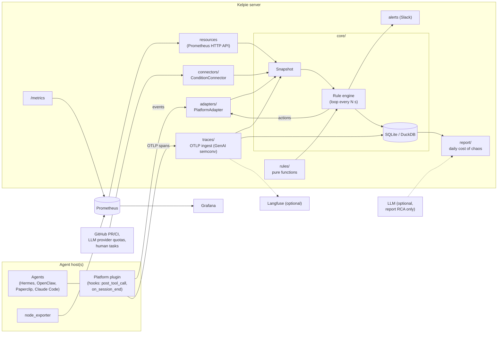

# Kelpie

> **Status: pre-alpha.** Interfaces, config and storage formats will change without notice.
> Most components below are design-level or stubs. Do not point Kelpie at a production
> task board with `dry_run` disabled yet.

**Open-source SRE and throughput optimization for AI agent farms**: Hermes, OpenClaw,
Paperclip, Claude Code and similar setups where many agents pull tasks from a shared board.

Kelpie is a **service, not an LLM agent**. It watches your task board, agent sessions,
traces and host resources, and applies **deterministic rules** to keep work flowing:
it requeues tasks that agents abandoned, wakes tasks whose wait condition is met, lifts
stale blocks, escalates review ping-pong and warns before disks, quotas or logins run out.
An LLM is optional and only used to write the root-cause section of the daily report.

- PyPI: `kelpie-sre` (not published yet) · CLI: `kelpie`
- License: Apache-2.0 · Repo: [github.com/ch8er/kelpie](https://github.com/ch8er/kelpie)

## Why

Agent farms fail in boring, repetitive ways, and every failure costs hours of idle agents.
The rules in Kelpie come from 13 real incidents on one farm:

| #  | Incident |
|----|----------|
| 1  | Guard block kept hanging although its condition was already met |
| 2  | Agent exited without a final status, or set a block without an allowed reason |
| 3  | Disk at 99% |
| 4  | Host overloaded, heavy task queue of 1.5–2 h |
| 5  | CI minutes ran out (11 h idle) |
| 6  | LLM rate limits and expired logins (up to 200 hits/day) |
| 7  | Conflicts in shared files (46 of 63 returns) |
| 8  | Block lingered 3 h after the cause was fixed |
| 9  | Idle time caused by an overly sequential task graph |
| 10 | Reviewer waited for CI inside its session; the dispatcher thought it was dead |
| 11 | Accepted task stuck in an ownerless status, with 7 dependents waiting |
| 12 | 9 review rounds on a single task |
| 13 | Human tasks blocking agents |

## Key ideas

- **Deterministic control loop.** Every N seconds the engine builds an immutable
  `Snapshot` (tasks, owners, dependencies, conditions, resources, sessions, spans) and runs
  every rule over it. No LLM is involved in deciding what to do.
- **Rules are pure functions.** A rule takes a snapshot and returns a list of `Action`s
  (`requeue`, `unblock`, `comment`, `wip_commit`, `wake`, `reassign`, `escalate`, `alert`).
  It does no I/O and reads time only from `snapshot.now`, so each rule is tested with
  plain YAML fixtures.
- **Actions only go through adapters.** The engine dispatches actions to a
  `PlatformAdapter`; rules never touch a platform directly. The engine is dry-run by default.
- **Core knows no platform and no CI.** `kelpie.core` never imports `adapters/` or
  `connectors/`; integrations implement protocols from `kelpie.core.ports`.
- **Don't reinvent monitoring.** Host resources come from node_exporter + Prometheus
  (read via the Prometheus HTTP API). Traces follow the OpenTelemetry GenAI semantic
  conventions and can be exported to Langfuse. Kelpie exposes its own `/metrics`.
- **Wait for conditions, don't poll inside sessions.** An agent registers a condition
  (CI green, PR merged, quota reset, human task done) and exits; Kelpie wakes the task when
  the condition holds.
- **Measure the cost of chaos.** A daily report shows idle hours, wasted tokens and
  returns per cause, plus the before/after effect of each fix.

## Architecture



The Kelpie server can run anywhere. Adapter plugins and node_exporter run where the
agents run.

## Rules (MVP)

| # | Rule | What it does | Incidents |
|---|------|--------------|-----------|
| 1 | Exit contract | Session ended without a final status, or with a block lacking an allowed reason → requeue | 2 |
| 2 | Wait for condition | Agent registers a condition and exits; Kelpie wakes the task when it holds. Detects in-session polling | 10 |
| 3 | Orphan statuses | Task sits in a status with no owner for more than N min → alert / reassign | 11 |
| 4 | Stale blocks | The block's cause is resolved in the outside world → unblock | 1, 8 |
| 5 | Ping-pong | After K review rounds → escalate | 12 |
| 6 | Bottlenecks and idle time | Idle time and queue depth by role; flags sequential graphs and human-task bottlenecks | 9, 10, 13 |
| 7 | Resources and quotas | Disk, memory, processes, LLM limits, CI minutes, expiring auth | 3, 4, 5, 6 |
| 8 | Daily report | "Cost of chaos" plus before/after effect of fixes | all |
| – | File contention (planned) | Detects concurrent edits to shared files and serializes them | 7 |

Foundation work alongside the rules: OTLP traces, checkpoints (commit reminders, WIP commit
on exit, resume from the last commit) and basic token optimization derived from traces.

## Quickstart

> While Kelpie is pre-alpha, `kelpie serve` only exposes `/metrics` and `/healthz`
> on port 9464; the control loop, adapters and connectors are not wired up yet.

Requirements: Python 3.12 and [uv](https://docs.astral.sh/uv/).

```bash
git clone https://github.com/ch8er/kelpie.git
cd kelpie
uv sync
uv run kelpie serve
```

Or run the full stack (Kelpie, Prometheus, Grafana) with Docker:

```bash
docker compose up
```

Install node_exporter and the platform plugin (for example the Hermes plugin) on each host
where agents run, and point them at the Kelpie server.

## Project layout

```text
src/kelpie/
  core/         domain model, rule contract, engine, ports (protocols), serde
  rules/        one module per rule: pure functions over a Snapshot
  adapters/     PlatformAdapter implementations (Hermes first)
  connectors/   ConditionConnector implementations (GitHub, LLM quotas, human tasks)
  traces/       OTLP ingest, span storage, optional Langfuse export
  report/       daily cost-of-chaos report, before/after comparisons
  cli.py, server.py     `kelpie` CLI and HTTP server (/metrics, /healthz)
tests/
  fixtures/incidents/   YAML snapshots + expected actions, one per incident scenario
deploy/                 Prometheus and Grafana config
docs/
  plan.md       3-week plan
  roadmap.md    issue list (source for scripts/create_issues.sh)
scripts/
  create_issues.sh      creates GitHub issues from docs/roadmap.md
docker-compose.yml      kelpie + prometheus + grafana
```

What exists today: the domain model, action types, the rule protocol and registry,
adapter/connector protocols, a minimal dry-run engine, fixture deserialization, the
`kelpie serve` HTTP stub and 13 incident fixtures. Adapters, connectors, traces, storage
and the report are stubs and no rule is implemented yet; see
[docs/plan.md](docs/plan.md) and [docs/roadmap.md](docs/roadmap.md).

## Contributing

See [CONTRIBUTING.md](CONTRIBUTING.md). Security issues: see [SECURITY.md](SECURITY.md).

## License

Apache License 2.0. See [LICENSE](LICENSE).
