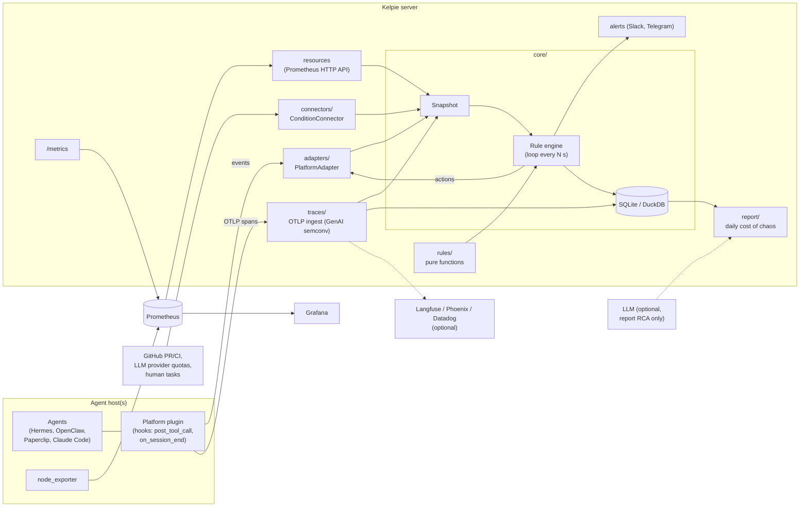

# Kelpie

> **Status: pre-alpha.** Interfaces, config and storage formats will change without notice.
> Most components below are design-level or stubs. Do not point Kelpie at a production
> task board with `dry_run` disabled yet.

**Open-source SRE and throughput optimization for AI agent farms**: Hermes, OpenClaw,
Paperclip, Claude Code, Codex and similar setups where many agents pull tasks from a shared
board, wherever they run: a laptop, a cloud VM, containers or Kubernetes.

Kelpie is a **service, not an LLM agent**. It watches your task board, agent sessions,
traces and host resources, and applies **deterministic rules** to keep work flowing:
it requeues tasks that agents abandoned, wakes tasks whose wait condition is met, lifts
stale blocks, escalates review ping-pong, cancels wasted CI builds, stops runaway loops
and warns before disks, quotas, logins or token budgets run out. An LLM is optional and only used for root-cause analysis in the
daily report.

Scope, priorities and order of work live in [docs/plan.md](docs/plan.md), the single source
of truth; the issue backlog is [docs/roadmap.md](docs/roadmap.md).

- PyPI: `kelpie-sre` (not published yet) · CLI: `kelpie`
- License: Apache-2.0 · Repo: [github.com/ch8er/kelpie](https://github.com/ch8er/kelpie)

## Why

Agent farms fail in boring, repetitive ways, and every failure costs hours of idle agents.
The rules in Kelpie come from 13 real incidents on one farm:

| #  | Incident | What Kelpie does |
|----|----------|------------------|
| 1  | Tasks stuck in the dispatcher guard (dozens of manual unblocks) | Stale blocks |
| 2  | Agent exited without a final status, or set a block instead of returning the task | Exit contract |
| 3  | Disk at 99% | Resources |
| 4  | Host overloaded, heavy task queue of 1.5–2 h | Resources + heavy-task concurrency limit |
| 5  | CI minutes ran out (11 h idle) | CI economy and quota burn forecast |
| 6  | LLM provider limits and expired logins (up to 200 hits/day) | Resources: provider quotas and auth health |
| 7  | Conflicts in shared files (46 of 63 returns) | Return causes: root-cause analysis from traces → recommendation; early conflict warning (rule 12, P1) |
| 8  | Block lingered 3 h after the cause was fixed | Stale blocks |
| 9  | Idle agents due to a sequential task graph | Bottlenecks: role utilization and critical path |
| 10 | Agent waited for an external event inside its session; the dispatcher declared it dead | Wait for condition + "waiting" heartbeat; bottlenecks |
| 11 | Task stuck in a status with no owner, 7 tasks blocked | Orphan statuses |
| 12 | 9 review rounds on a single task | Ping-pong → escalation |
| 13 | Human tasks blocked agents | "Needs you" inbox: humans in the task graph, with cost of delay (rule 13, P1) |

Kelpie must also measure the effect of a fix by itself. Example from the farm: after a
manual fix, review time dropped from 48 to 27 minutes, and failures from 9 of 29 to 1 of 11.

**Field evidence from other farms.** The same failure modes show up on other platforms,
plus two that the 13 incidents do not cover and that became P0 rules 10 and 11: runaway
loops (a heartbeat loop repeated the same tool call about 900 times overnight, each time
resending about 80k input tokens) and activity without progress (an idle agent resending a
12k-token context every 5 minutes with no status change, commit or artifact). Single-session
loop guards exist only for some platforms: [AgentWatchdog](https://github.com/jusong/agentwatchdog)
covers Claude Code only, and OpenClaw closed the request for one as "not planned"
([openclaw/openclaw#159329](https://github.com/openclaw/openclaw/issues/159329)). Kelpie's
breaker works on traces, so it covers any platform that sends them. Other field signals
(tasks that stop silently, conflicts found only at merge, "done" without evidence, humans
as the hidden queue, gate violations after context compaction) are in the P1 and P2 backlog.

## Key ideas

- **Deterministic control loop.** Every N seconds the engine builds an immutable
  `Snapshot` (tasks, owners, dependencies, conditions, resources, sessions, spans) and runs
  every rule over it. No LLM is involved in deciding what to do.
- **Rules are pure functions.** A rule takes a snapshot and returns a list of `Action`s
  (`requeue`, `unblock`, `comment`, `wip_commit`, `wake`, `reassign`, `stop`, `escalate`,
  `alert`).
  It does no I/O and reads time only from `snapshot.now`, so each rule is tested with
  plain YAML fixtures.
- **Actions only go through executors.** The engine routes each action to the platform
  adapter the task came from, or to a connector that can act (a CI connector cancels a
  superseded build); rules never touch a platform directly. Optional capabilities (reassign,
  stop) fall back to an alert when an adapter lacks them. Every action is fingerprinted in
  an action ledger with a cooldown and a per-task rate limit, so Kelpie cannot loop on its
  own output.
- **Observe first.** Each rule runs in `observe`, `suggest` or `act` mode (default
  `observe`); a global dry-run switch overrides them all.
- **Core knows no platform and no CI.** `kelpie.core` never imports `adapters/` or
  `connectors/`; integrations implement protocols from `kelpie.core.ports`.
- **Don't reinvent monitoring.** Host resources come from node_exporter + Prometheus
  (read via the Prometheus HTTP API). Traces follow the OpenTelemetry GenAI semantic
  conventions and can be exported to Langfuse. Kelpie exposes its own `/metrics`.
- **Wait for conditions, don't poll inside sessions.** An agent registers a condition
  (CI green, PR merged, quota reset, human task done) and exits; Kelpie wakes the task when
  the condition holds.
- **Measure the cost of chaos.** A daily report shows idle hours and tokens burned on
  restarts, what Kelpie fixed, what needs a human, and the before/after effect of each fix.

**Use what exists, do not build.** Kelpie runs on top of platforms, not instead of them.
"Who is doing what" dashboards already exist (Claude Code Agent View, hermes-monitor,
Minions). Single-session loop and budget thresholds come from AgentWatchdog (Claude Code
only): rule 10 reuses them as defaults (8 repeats in 10 minutes, 5 errors in a row) and
applies them across platforms from traces. Deep single-agent optimization is left to HALO,
Langfuse and Papaya via trace export. Kelpie's value is logic over the task graph and
automatic repair.

## Architecture



The Kelpie server can run anywhere. Adapter plugins and node_exporter run where the
agents run. Hermes is the first platform adapter; Claude Code (first candidate), Paperclip,
OpenClaw, Codex and a GitHub Issues / Linear task-queue adapter are P2, built on signal.

## Rules

P0 is the MVP; P1 and P2 rules are backlog.

| # | Rule | What it does | Incidents |
|---|------|--------------|-----------|
| 1 | Exit contract | Session ended without a final status, or with a block lacking an allowed reason → requeue | 2 |
| 2 | Wait for condition | Agent registers a condition and exits; Kelpie wakes the task when it holds and keeps a "waiting" heartbeat meanwhile. Detects in-session polling | 10 |
| 3 | Orphan statuses | Task sits in a status with no owner for more than N min → alert and reassign to an owner of its role | 11 |
| 4 | Stale blocks | The block's cause is resolved in the outside world → unblock | 1, 8 |
| 5 | Ping-pong | After K review rounds → escalate to the architect or a human | 12 |
| 6 | Bottlenecks | Role utilization and critical path → alert with a rebalancing suggestion | 9, 10 |
| 7 | Resources | Disk, memory, processes, heavy-task concurrency, LLM provider quotas and auth health → alert before the agents stop | 3, 4, 6 |
| 8 | Daily report | "Cost of chaos" plus before/after verification of every fix | all |
| 9 | CI economy | Finds wasted builds (drafts/WIP, superseded, docs-only, already verified commit), cancels superseded ones, forecasts quota burn, proposes a better CI config PR | 5 |
| 10 | Loop and budget breaker | N identical consecutive tool calls (same tool and arguments hash; default 8 in 10 min), 5 tool errors in a row, or a per-agent daily/nightly token budget exceeded → stop the run through the adapter and alert | field |
| 11 | Activity without progress | Tokens spent with no status change, commit or artifact → alert with recommendations (longer heartbeat interval, cheaper maintenance model, bounded sessions with a handoff file) | field |
| – | Return causes (P1) | Root-cause analysis of task returns from traces → recommendation | 7 |
| 12 | Conflict warning (P1) | Two live tasks editing the same files → warn or serialize | 7 |
| 13 | "Needs you" inbox (P1) | Everything waiting for a human, sorted by cost of delay; agents waiting for approval too long | 13 |
| 14 | Compaction gate (P2) | Agent acts against the task's gate right after a context compaction | field |

P1 also extends rule 1 ("done" requires evidence; reopened-after-done rate) and rule 3 (stop
patterns: tasks that nothing will move again, plus `kelpie why <task>`). "Field" means field
evidence from other farms rather than one of the 13 incidents.

Rule names in code: `exit_contract`, `wait_condition`, `orphan_status`, `stale_blocks`,
`ping_pong`, `bottlenecks`, `resources`, `ci_economy`, `loop_breaker`, `no_progress`,
`conflict_warning`, `needs_you`, `compaction_gate`, `return_causes`, `checkpoints`.

Foundation work alongside the rules (no LLM): **traces** (OpenTelemetry GenAI spans over
OTLP, stored locally, optionally forwarded to Langfuse, Phoenix or Datadog; adapters write
spans from hooks if a platform emits none) and **checkpoints** (commit reminder after N
minutes or M changed files, WIP commit on exit to a draft PR or with `[skip ci]`, resume
from the last commit with a progress note). Next step (P1): basic token optimization and
farm throughput metrics from traces.

## Reporting (planned)

- **Real-time alerts** to Slack (P0) or Telegram (P1): only actionable items, always stating what
  Kelpie already did by itself; duplicate alerts are merged.
- **Daily report**: cost of chaos (idle hours, tokens burned on restarts), what Kelpie
  fixed by itself, what needs a human decision, before/after effect of yesterday's fixes,
  top 3 optimization recommendations.
- **Dashboards**: no custom UI. Kelpie exposes Prometheus metrics on `/metrics`, Grafana
  shows them, traces open in Langfuse. CLI: `kelpie status` and `kelpie report`.

## Quickstart

> While Kelpie is pre-alpha, `kelpie serve` runs the control loop and exposes `/metrics` and
> `/healthz` on port 9464. Without an `[adapters.hermes]` section the snapshot is empty. It
> starts safe: global dry-run on, every rule in observe mode.

Requirements: Python 3.12 and [uv](https://docs.astral.sh/uv/).

```bash
git clone https://github.com/ch8er/kelpie.git
cd kelpie
uv sync
cp kelpie.example.toml kelpie.toml   # optional; every key has a safe default
uv run kelpie status                 # rules that would load, with their mode
uv run kelpie serve
```

Or run the full stack (Kelpie, Prometheus, Grafana) with Docker:

```bash
cp .env.example .env   # set GRAFANA_ADMIN_PASSWORD
docker compose up
```

Ports are bound to `127.0.0.1` (Kelpie 9464, Prometheus 9090, Grafana 3000). Add
`--profile local-agents` to also run node_exporter when agents share the server host.

To watch a Hermes farm (read only, observe mode), add the section below to `kelpie.toml`
and install the hooks plugin on the Hermes host; see
[`src/kelpie/adapters/hermes/README.md`](src/kelpie/adapters/hermes/README.md). Hermes
actions are not implemented yet, so rules cannot change the board.

```toml
[adapters.hermes]
db_path = "~/.hermes/kanban.db"

# Hermes tolerates heartbeats up to an hour old (Kelpie's default is 30 minutes).
[engine.rules.exit_contract]
session_stale_after = "60m"
```

`kelpie.example.toml` has the same for `orphan_status` and `wait_condition`, and the
alternative `allowed_block_reasons` list for Hermes block kinds.

Install node_exporter on each host where agents run, and point it at the Kelpie server.

## Traces (OTLP)

`kelpie serve` accepts OpenTelemetry traces on the same port: `POST /v1/traces`, OTLP/HTTP
with `application/x-protobuf` or `application/json` bodies, optionally gzip-compressed
(gRPC is not supported: point exporters at the HTTP endpoint). Spans are mapped onto
Kelpie's model following the
[GenAI semantic conventions](https://github.com/open-telemetry/semantic-conventions-genai)
and stored in the Kelpie database; each control-loop tick sees the spans of the last
`window` (30 minutes; rules look back about 10) plus per-session totals (calls, errors,
tokens) over `totals_window` (24 hours, refreshed once a minute). Ticks read only the spans
that changed since the previous tick, through a separate database connection, so they do
not hold up ingest; at most `max_snapshot_spans` (50,000, newest first) reach a snapshot
(`kelpie_snapshot_spans_dropped_total` counts the rest). Spans older than `retention`
(7 days) or beyond `max_rows` are pruned once an hour in the background. Spans that start or
end more than an hour in the future, or ended before `retention`, are rejected as
`invalid_time`.

| `gen_ai.operation.name` | Kelpie span kind |
| --- | --- |
| `chat`, `text_completion`, `generate_content`, `embeddings` | LLM call |
| `execute_tool` | tool call |
| `invoke_agent` | session |
| `invoke_workflow` | task |

Other spans with a model or token usage count as LLM calls, with `gen_ai.tool.name` as tool
calls; spans that are not GenAI steps (HTTP spans and the like) are used to link their
children and then dropped. Mapped: model (`gen_ai.response.model`, else
`gen_ai.request.model`), `gen_ai.usage.input_tokens`, `output_tokens` and
`cache_read.input_tokens`, `gen_ai.tool.name`, outcome (`error` when the span status is
ERROR or `error.type` is set). Input tokens include cached tokens, as in the conventions;
Claude Code's Anthropic-style counts are normalized to that on arrival. Session totals sum
LLM spans; an LLM span nested in another LLM span (two instrumentation layers) is counted
twice. Tool calls get an `args_hash` of their arguments (the same
hash the Hermes hooks plugin writes), which the loop breaker compares.

**Task and session.** `task_id` comes from the `kelpie.task_id` attribute and `session_id`
from `kelpie.session_id`, else `gen_ai.conversation.id`, else `session.id` (both keys are
configurable). Span attributes win over resource attributes, so an agent host can tag a
whole process with `OTEL_RESOURCE_ATTRIBUTES=kelpie.task_id=T-42`. A span without them
inherits its parent's, also when the parent arrives in a later request.

**Privacy.** Kelpie keeps span attributes only from an allowlist: GenAI request
parameters, response id, model and finish reasons, usage counters, tool name, call id and
type, agent and conversation ids, `error.type`, `server.address`/`port`, `service.name`,
`session.id`, `kelpie.*`, and Claude Code's timing and status fields. Everything else is
dropped on arrival, whatever the instrumentation calls it: messages, prompts, completions,
reasoning, tool arguments and results (OpenTelemetry GenAI, OpenLLMetry, OpenInference,
Vercel AI SDK, Langfuse, MLflow and others), error messages, and user or organization
identity. Tool arguments are reduced to `args_hash` first. Kept values are scalars, cut to
256 characters, at most 64 keys per span. Span events are ignored.

**Authentication.** Set `KELPIE_TRACES_TOKEN` and exporters must send
`Authorization: Bearer <token>`. Without a token, `kelpie serve` only starts on a loopback
address (`--host 127.0.0.1`); to accept spans without a token on another address (inside a
container whose port is published on 127.0.0.1, or behind a proxy that authenticates), set
`allow_unauthenticated = true` or `KELPIE_TRACES_ALLOW_UNAUTHENTICATED=1` on purpose;
`docker-compose.yml` does the latter. Headers and the token are checked before the body is
read; at most `max_concurrent_requests` (4) exports are decoded at once (more get 503 and
are retried by the exporter), and a client that stalls for 30 seconds is disconnected.

```toml
[traces]
token_env = "KELPIE_TRACES_TOKEN"  # configuring it makes the variable mandatory
window = "30m"
retention = "7d"
```

**Claude Code** exports spans as a beta feature (verified against the
[monitoring docs](https://code.claude.com/docs/en/monitoring-usage)); Kelpie reads its
`claude_code.llm_request` and `claude_code.tool` spans and links them by `session.id`:

```bash
export CLAUDE_CODE_ENABLE_TELEMETRY=1
export CLAUDE_CODE_ENHANCED_TELEMETRY_BETA=1
export OTEL_TRACES_EXPORTER=otlp
export OTEL_EXPORTER_OTLP_TRACES_PROTOCOL=http/protobuf
export OTEL_EXPORTER_OTLP_TRACES_ENDPOINT=http://kelpie.internal:9464/v1/traces
export OTEL_EXPORTER_OTLP_TRACES_HEADERS="Authorization=Bearer ${KELPIE_TRACES_TOKEN}"
export OTEL_RESOURCE_ATTRIBUTES="kelpie.task_id=T-42"   # optional: link to a board task
```

Tool arguments are redacted by Claude Code by default; with `OTEL_LOG_TOOL_DETAILS=1` its
Bash command and file path are hashed into `args_hash` and dropped.

**Hermes.** The Kelpie hooks plugin already reports every tool call (see the Hermes
adapter README). If Hermes also exports the same calls over OTLP, both copies reach the
snapshot for now: de-duplication of hook and OTLP spans comes with the hooks helper. For model calls and token usage, Hermes' bundled Langfuse plugin only
talks to Langfuse; the community [hermes-otel](https://github.com/briancaffey/hermes-otel)
plugin can export to any OTLP/HTTP endpoint (`type: otlp` backend in
`~/.hermes/hermes_otel.yaml`). We have not verified how it sets request headers, so run
Kelpie's ingest without a token on a private network if it cannot send one.

**Any other OpenTelemetry SDK**: `OTEL_EXPORTER_OTLP_TRACES_ENDPOINT=http://<kelpie>:9464/v1/traces`,
`OTEL_EXPORTER_OTLP_TRACES_PROTOCOL=http/protobuf` and the bearer header as above.

## Project layout

```text
src/kelpie/
  core/         domain model, rule contract, engine, ports (protocols), serde
  rules/        one module per rule: pure functions over a Snapshot
  adapters/     PlatformAdapter implementations (Hermes first)
  connectors/   ConditionConnector implementations (GitHub, LLM quotas, human tasks)
  traces/       OTLP ingest, span storage, optional export (Langfuse, Phoenix, Datadog)
  report/       daily cost-of-chaos report, before/after comparisons
  cli.py, server.py     `kelpie` CLI and HTTP server (/metrics, /healthz, /v1/traces)
tests/
  fixtures/incidents/   YAML snapshots + expected actions, one or more per incident
deploy/                 Prometheus and Grafana config
docs/
  plan.md       scope, priorities and 3-week plan (single source of truth)
  roadmap.md    issue list (source for scripts/create_issues.sh)
scripts/
  create_issues.sh      creates GitHub issues from docs/roadmap.md
docker-compose.yml      kelpie + prometheus + grafana
```

What exists today: the domain model, action types, the rule protocol and registry,
adapter/connector protocols, the read side of the Hermes adapter (kanban.db and a hooks
plugin), the engine (routing to executors, per-rule modes, action
ledger in SQLite), `kelpie serve` with the control loop and engine metrics, OTLP trace
ingest with span storage, `kelpie
status`, and fixtures for the 13 farm incidents and for field evidence. Hermes actions,
other adapters, connectors, trace forwarding, alerters and the report are stubs, `kelpie report` does not exist yet,
and rules 1–4 (`exit_contract`, `wait_condition`, `orphan_status`, `stale_blocks`) are
implemented; see
[docs/plan.md](docs/plan.md) and [docs/roadmap.md](docs/roadmap.md).

## Contributing

See [CONTRIBUTING.md](CONTRIBUTING.md). Security issues: see [SECURITY.md](SECURITY.md).

## License

Apache License 2.0. See [LICENSE](LICENSE).
