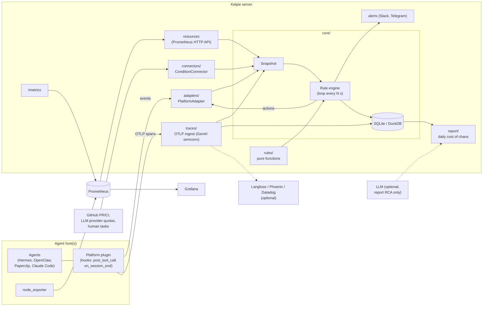

# Kelpie

> **Status: pre-alpha.** Interfaces, config and storage formats will change without notice.
> Most components below are design-level or stubs. Do not point Kelpie at a production
> task board with `dry_run` disabled yet.

**Open-source SRE and throughput optimization for AI agent farms**: Hermes, OpenClaw,
Paperclip, Claude Code, Codex and similar setups where many agents pull tasks from a shared
board, wherever they run: a laptop, a cloud VM, containers or Kubernetes.

Kelpie is a **service, not an LLM agent**. It watches your task board, agent sessions,
traces and host resources, and applies **deterministic rules** to keep work flowing:
it requeues tasks that agents abandoned, wakes tasks whose wait condition is met, lifts
stale blocks, escalates review ping-pong, cancels wasted CI builds, stops runaway loops
and warns before disks, quotas, logins or token budgets run out. An LLM is optional and only used for root-cause analysis in the
daily report.

Scope, priorities and order of work live in [docs/plan.md](docs/plan.md), the single source
of truth; the issue backlog is [docs/roadmap.md](docs/roadmap.md).

- PyPI: `kelpie-sre` (not published yet) · CLI: `kelpie`
- License: Apache-2.0 · Repo: [github.com/ch8er/kelpie](https://github.com/ch8er/kelpie)

## Why

Agent farms fail in boring, repetitive ways, and every failure costs hours of idle agents.
The rules in Kelpie come from 13 real incidents on one farm:

| #  | Incident | What Kelpie does |
|----|----------|------------------|
| 1  | Tasks stuck in the dispatcher guard (dozens of manual unblocks) | Stale blocks |
| 2  | Agent exited without a final status, or set a block instead of returning the task | Exit contract |
| 3  | Disk at 99% | Resources |
| 4  | Host overloaded, heavy task queue of 1.5–2 h | Resources + heavy-task concurrency limit |
| 5  | CI minutes ran out (11 h idle) | CI economy and quota burn forecast |
| 6  | LLM provider limits and expired logins (up to 200 hits/day) | Resources: provider quotas and auth health |
| 7  | Conflicts in shared files (46 of 63 returns) | Return causes: root-cause analysis from traces → recommendation; early conflict warning (rule 12) |
| 8  | Block lingered 3 h after the cause was fixed | Stale blocks |
| 9  | Idle agents due to a sequential task graph | Bottlenecks: role utilization and critical path |
| 10 | Agent waited for an external event inside its session; the dispatcher declared it dead | Wait for condition + "waiting" heartbeat; bottlenecks |
| 11 | Task stuck in a status with no owner, 7 tasks blocked | Orphan statuses |
| 12 | 9 review rounds on a single task | Ping-pong → escalation |
| 13 | Human tasks blocked agents | "Needs you" inbox: humans in the task graph, with cost of delay (rule 13, P1) |

Kelpie must also measure the effect of a fix by itself. Example from the farm: after a
manual fix, review time dropped from 48 to 27 minutes, and failures from 9 of 29 to 1 of 11.

**Field evidence from other farms.** The same failure modes show up on other platforms,
plus two that the 13 incidents do not cover and that became P0 rules 10 and 11: runaway
loops (a heartbeat loop repeated the same tool call about 900 times overnight, each time
resending about 80k input tokens) and activity without progress (an idle agent resending a
12k-token context every 5 minutes with no status change, commit or artifact). Single-session
loop guards exist only for some platforms: [AgentWatchdog](https://github.com/jusong/agentwatchdog)
covers Claude Code only, and OpenClaw closed the request for one as "not planned"
([openclaw/openclaw#159329](https://github.com/openclaw/openclaw/issues/159329)). Kelpie's
breaker works on traces, so it covers any platform that sends them. Other field signals
(tasks that stop silently, conflicts found only at merge, "done" without evidence, humans
as the hidden queue, gate violations after context compaction) are in the P1 and P2 backlog.

## Key ideas

- **Deterministic control loop.** Every N seconds the engine builds an immutable
  `Snapshot` (tasks, owners, dependencies, conditions, resources, sessions, spans) and runs
  every rule over it. No LLM is involved in deciding what to do.
- **Rules are pure functions.** A rule takes a snapshot and returns a list of `Action`s
  (`requeue`, `unblock`, `comment`, `wip_commit`, `wake`, `wait`, `reassign`, `stop`,
  `cancel_build`, `escalate`, `alert`).
  It does no I/O and reads time only from `snapshot.now`, so each rule is tested with
  plain YAML fixtures.
- **Actions only go through executors.** The engine routes each action to the platform
  adapter the task came from, or to a connector that can act (a CI connector cancels a
  superseded build); rules never touch a platform directly. Optional capabilities (reassign,
  stop, wait) fall back to an alert when an adapter lacks them, and so does any action an
  adapter refuses with `UnsupportedAction` (its platform does not allow it). Every action is
  fingerprinted in an action ledger with a cooldown and a per-task rate limit, so Kelpie
  cannot loop on its own output.
- **Observe first.** Each rule runs in `observe`, `suggest` or `act` mode (default
  `observe`); a global dry-run switch overrides them all.
- **Core knows no platform and no CI.** `kelpie.core` never imports `adapters/` or
  `connectors/`; integrations implement protocols from `kelpie.core.ports`.
- **Don't reinvent monitoring.** Host resources come from node_exporter + Prometheus
  (read via the Prometheus HTTP API). LLM provider quotas and key health come from
  zero-cost probes of the provider APIs (`[connectors.llm_quotas]`, providers are config
  data, no provider SDK). Traces follow the OpenTelemetry GenAI semantic
  conventions and can be exported to Langfuse. Kelpie exposes its own `/metrics`.
- **Wait for conditions, don't poll inside sessions.** An agent registers a condition
  (CI green, PR merged, quota reset, human task done) and exits; Kelpie wakes the task when
  the condition holds.
- **Measure the cost of chaos.** A daily report shows idle hours and tokens burned on
  restarts, what Kelpie fixed, what needs a human, and the before/after effect of each fix.

**Use what exists, do not build.** Kelpie runs on top of platforms, not instead of them.
"Who is doing what" dashboards already exist (Claude Code Agent View, hermes-monitor,
Minions). Single-session loop and budget thresholds come from AgentWatchdog (Claude Code
only): rule 10 reuses them as defaults (8 repeats in 10 minutes, 5 errors in a row) and
applies them across platforms from traces. Deep single-agent optimization is left to HALO,
Langfuse and Papaya via trace export. Kelpie's value is logic over the task graph and
automatic repair.

## Architecture



The Kelpie server can run anywhere. Adapter plugins and node_exporter run where the
agents run. Hermes is the first platform adapter; Claude Code (first candidate), Paperclip,
OpenClaw, Codex and a GitHub Issues / Linear task-queue adapter are P2, built on signal.

## Rules

P0 is the MVP; P1 and P2 rules are backlog.

| # | Rule | What it does | Incidents |
|---|------|--------------|-----------|
| 1 | Exit contract | Session ended without a final status, or with a block lacking an allowed reason → requeue | 2 |
| 2 | Wait for condition | Agent registers a condition and exits; Kelpie wakes the task when it holds and keeps a "waiting" heartbeat meanwhile. Detects in-session polling | 10 |
| 3 | Orphan statuses | Task sits in a status with no owner for more than N min → alert and reassign to an owner of its role | 11 |
| 4 | Stale blocks | The block's cause is resolved in the outside world → unblock | 1, 8 |
| 5 | Ping-pong | After K review rounds → escalate to the architect or a human | 12 |
| 6 | Bottlenecks | Role utilization and critical path → alert with a rebalancing suggestion; idle with ready work, holds with an owner and an expiry, human tasks on the critical path | 9, 10, 14, 16 |
| 7 | Resources | Disk, memory, processes, heavy-task concurrency, LLM provider quotas and auth health → alert before the agents stop | 3, 4, 6 |
| 8 | Daily report | "Cost of chaos" plus before/after verification of every fix | all |
| 9 | CI economy | Finds wasted builds (drafts/WIP, superseded, docs-only, already verified commit), cancels superseded ones, forecasts quota burn; proposing a better CI config PR is P1 | 5 |
| 10 | Loop and budget breaker | N identical consecutive tool calls (same tool and arguments hash; default 8 in 10 min), 5 tool errors in a row, or a per-agent daily/nightly token budget exceeded → stop the run through the adapter and alert | field |
| 11 | Activity without progress | Tokens spent with no status change, commit or artifact → alert with recommendations (longer heartbeat interval, cheaper maintenance model, bounded sessions with a handoff file) | field |
| – | Return causes (P1) | Root-cause analysis of task returns from traces → recommendation | 7 |
| 12 | Conflict warning | Two live tasks editing the same files → comment on both; optionally hold the later one until the earlier is done (needs an adapter that reports `Task.files`) | 7 |
| – | Dispatch gate | A ready task whose prerequisite is not met (a referenced PR red or not merged, a parent task not done) → parked in waiting on it; rule 2 wakes it | field |
| 13 | "Needs you" inbox (P1) | Everything waiting for a human, sorted by cost of delay; agents waiting for approval too long | 13 |
| 14 | Compaction gate (P2) | Agent acts against the task's gate right after a context compaction | field |

P1 also extends rule 1 ("done" requires evidence; reopened-after-done rate) and rule 3 (stop
patterns: tasks that nothing will move again, plus `kelpie why <task>`). "Field" means field
evidence from other farms rather than one of the 13 incidents.

Rule names in code: `exit_contract`, `wait_condition`, `orphan_status`, `stale_blocks`,
`ping_pong`, `bottlenecks`, `resources`, `ci_economy`, `loop_breaker`, `no_progress`,
`conflict_warning`, `dispatch_gate`, `needs_you`, `compaction_gate`, `return_causes`, `checkpoints`.

Foundation work alongside the rules (no LLM): **traces** (OpenTelemetry GenAI spans over
OTLP, stored locally, optionally forwarded to Langfuse, Phoenix or Datadog; adapters write
spans from hooks if a platform emits none) and **checkpoints** (commit reminder after N
minutes or M changed files, WIP commit on exit to a draft PR or with `[skip ci]`, resume
from the last commit with a progress note). Next step (P1): basic token optimization and
farm throughput metrics from traces.

## Reporting

- **Real-time alerts** to Telegram and Slack: only actionable
  items, always stating what Kelpie already did by itself; duplicate alerts are merged.
  See [Alerts](#alerts).
- **Daily report** (`kelpie report`): cost of chaos in condition-hours and dollars, cost per
  completed task, what Kelpie fixed by itself (and would have fixed in act mode), what
  needs a human (alert states still open, actions Kelpie could not carry out, repeated
  huge-output offenders), the top 3 recommendations and the largest tool outputs. See
  [Daily report](#daily-report), including the before/after effect of yesterday's fixes.
- **Dashboards**: no custom UI. Kelpie exposes Prometheus metrics on `/metrics`, Grafana
  shows them, traces open in Langfuse. CLI: `kelpie status` and `kelpie report`.

## Daily report

`kelpie report [--date YYYY-MM-DD] [--send]` builds one day's report (default: yesterday in
`[report] timezone`) from Kelpie's database, read-only, and from the board as the adapters
report it now. It prints Markdown, writes `kelpie-report-<date>.md` to `[report] dir`, and
with `--send` posts a short summary to the alert channels. The same data gives the same
report; no LLM is involved.

- **Cost of chaos, hours**: long-lived alert states of the rules that describe stuck work
  (ownerless tasks, blocks that outlived their cause, waits past their limit, review
  ping-pong, idle capacity behind bottlenecks and human gates, runaway loops, activity
  without progress),
  from when Kelpie first reported the condition to when it last saw it, clipped to the
  day (a lower bound: a grace period or an allowed wait is not counted). The unit is
  condition-hours; forgotten holds (rule 6) count the idle agent-hours behind them instead,
  from the idle agents rule 6 reports while the hold stays open. `[report] hour_usd` prices
  both.
- **Cost of chaos, dollars**: tokens burned by runaway and no-progress sessions while
  flagged, and by every session `exit_contract` requeued (a restart), priced with
  `[prices]`. In subscription mode the dollars are marked as an estimate.
- **Cost per completed task**: the day's priced spend over the tasks that reached `done`.
- **Top 3 recommendations**: output filters for huge tool outputs (RTK first; see
  `[traces.outputs]`), rules that would have fixed part of the chaos in act mode, and fixed
  remedies for the largest causes, ranked by dollars (hours count when `hour_usd` is set).

**Before/after of fixes.** Every fix made on the report's day or the day before is measured
over `[report] verify_window` (a day) before and after it: stuck condition-hours per day
(only the fix's rule when it names one), tokens per day, task returns per day, review time
(sessions of `review_roles`), sessions that failed or ended without a status, and for a
command fix the output tokens per call. A side with fewer than `min_sample` observations,
or an after-window under a quarter of the window, is labelled a small sample. Fixes come
from `kelpie fix "lifted the merge hold" [--rule R] [--command PREFIX] [--role ROLE]
[--at TIME]` (check with `kelpie fix --list [--days N]`), from config changes (`kelpie serve` notes when its config file changed), from
rule mode changes in the action ledger (observe to act, dry-run off) and from output
filters that appear in traces (`rtk`, `| xcbeautify`). Board-based metrics (review time,
failures, returns) need the adapters to look back `1d + 2 x verify_window` when the report
runs (Hermes: `lookback = "72h"` with the defaults), and spans must be kept as long
(`[traces] retention`, 7d by default). `kelpie fix --at` without an offset is read in
`[report] timezone`; it needs the database `kelpie serve` creates. Mode changes are placed
at the first ledger entry in the new mode, so a quiet rule's switch shows up late.

Schedule it on the host, shortly after midnight in the report's time zone, e.g. with cron:
`5 0 * * * kelpie --config /etc/kelpie.toml report --send`. Adapters only look back so far
(Hermes: `lookback`, 24h), so run it daily rather than for days long past.

## Alerts

Alerts are off until a channel is configured. Each `[[alerts.channels]]` entry has its own
`min_severity`; an alert goes to every channel it reaches. Delivery runs on a background
worker per channel (bounded queue), so a slow chat service never stalls the control loop.
Transient failures (429, 5xx, network) are retried for `retry_horizon` (default `15m`, under
`[alerts]`) with a capped backoff; an alert that is still undelivered is lost and counted in
`kelpie_alerts_failed_total`. The bundled Prometheus rule `KelpieAlertDeliveryFailed`
(`deploy/prometheus/rules/kelpie.yml`) fires on it, and the Grafana dashboard has an Alerts
row. Drops (full queue, duplicates, shutdown) are counted in `kelpie_alerts_dropped_total`.
Alerts still waiting when Kelpie shuts down during a chat outage are counted as
`kelpie_alerts_dropped_total{reason="shutdown"}`, not as failed, so `KelpieAlertDeliveryFailed`
does not fire for them.

```toml
[[alerts.channels]]
type = "telegram"
token_env = "KELPIE_TELEGRAM_TOKEN"   # the bot token is read from this variable
chat_id = "-1001234567890"
min_severity = "warning"

[[alerts.channels]]
type = "slack"
webhook_env = "KELPIE_SLACK_WEBHOOK"  # an incoming-webhook URL is read from this variable
min_severity = "critical"
```

The token and the webhook URL are never logged or shown, and a missing or malformed one stops
Kelpie at startup (a Slack webhook must be https on `hooks.slack.com`). Slack messages are
plain text with `&`, `<` and `>` escaped, so task text cannot become a mention (in Telegram,
`@` in task text is shown as a fullwidth `＠`, and invisible format characters are removed).
Every message
states the transition (new, still open, changed, resolved) and what Kelpie already did.
See `kelpie.example.toml`.

## Quickstart

> While Kelpie is pre-alpha, `kelpie serve` runs the control loop and exposes `/metrics` and
> `/healthz` on port 9464. Without an `[adapters.hermes]` section the snapshot is empty. It
> starts safe: global dry-run on, every rule in observe mode.

Requirements: Python 3.12 and [uv](https://docs.astral.sh/uv/).

```bash
git clone https://github.com/ch8er/kelpie.git
cd kelpie
uv sync
cp kelpie.example.toml kelpie.toml   # optional; every key has a safe default
uv run kelpie status                 # rules that would load, with their mode
uv run kelpie serve                  # listens on 127.0.0.1:9464; --host 0.0.0.0 to expose
```

Or run the full stack (Kelpie, Prometheus, Grafana) with Docker:

```bash
cp .env.example .env   # set GRAFANA_ADMIN_PASSWORD
docker compose up
```

Ports are bound to `127.0.0.1` (Kelpie 9464, Prometheus 9090, Grafana 3000). Add
`--profile local-agents` to also run node_exporter when agents share the server host.

Step by step for a first live run on a Hermes farm, with `kelpie doctor`:
[`docs/quickstart-hermes.md`](docs/quickstart-hermes.md).

To watch a Hermes farm (observe mode), add the section below to `kelpie.toml`
and install the hooks plugin on the Hermes host; see
[`src/kelpie/adapters/hermes/README.md`](src/kelpie/adapters/hermes/README.md). Hermes
can carry out only `stop` (rule 10 in `act` mode) for now: it blocks the running task
through the Hermes CLI. Other rules cannot change the board yet.

```toml
[adapters.hermes]
db_path = "~/.hermes/kanban.db"

# Hermes tolerates heartbeats up to an hour old (Kelpie's default is 30 minutes).
[engine.rules.exit_contract]
session_stale_after = "60m"
```

`kelpie.example.toml` has the same for `orphan_status` and `wait_condition`, and the
alternative `allowed_block_reasons` list for Hermes block kinds.

Install node_exporter on each host where agents run, and point it at the Kelpie server.

## Host resources (optional)

Rule 7 (`resources`) warns before a host runs out of disk, memory, CPU or processes and
suggests a limit on heavy tasks when a host is overloaded. It reads node_exporter metrics
through the Prometheus HTTP API (`GET /api/v1/query`); Kelpie has no collector of its own.
Off unless configured:

```toml
[resources.prometheus]
url = "http://prometheus:9090"
hosts = { host-a = "host-a:9100" }   # Kelpie host name = value of the `instance` label
# token_env = "KELPIE_PROMETHEUS_TOKEN"  # bearer token from this env var, sent only to `url`

[engine.rules.resources]
mode = "suggest"
disk_warning = 0.85
disk_critical = 0.95
heavy_label = "heavy"               # tasks with this label are heavy
max_heavy_per_host = 2              # alert when an overloaded host runs more at once
```

Per-host heavy-task limits need the platform adapter to report where each task runs
(`Task.host`); the Hermes adapter does not yet, so with several hosts Kelpie can only say
that the farm runs too many heavy tasks while some host is overloaded. Disk, memory and
load alerts do not depend on it. CPU alerts are off by default (load covers overload), and
the default process ceiling is the kernel's `pid_max`, so process alerts rarely fire.

Redirects and proxies are never followed, and the token is never logged. If Prometheus is
down, rules see no host readings (never stale ones), the failure is counted in
`kelpie_resource_read_failures_total` and logged once per cause. Queries are configurable
under `[resources.prometheus.queries]`; see `kelpie.example.toml`. LLM provider quotas and
auth health are not part of this step yet.

## Traces (OTLP)

`kelpie serve` accepts OpenTelemetry traces on the same port: `POST /v1/traces`, OTLP/HTTP
with `application/x-protobuf` or `application/json` bodies, optionally gzip-compressed
(gRPC is not supported: point exporters at the HTTP endpoint). Spans are mapped onto
Kelpie's model following the
[GenAI semantic conventions](https://github.com/open-telemetry/semantic-conventions-genai)
and stored in the Kelpie database; each control-loop tick sees the spans of the last
`window` (30 minutes; rules look back about 10) plus per-session totals (calls, errors,
tokens) over `totals_window` (24 hours, refreshed once a minute). Ticks read only the spans
that changed since the previous tick, through a separate database connection, so they do
not hold up ingest; at most `max_snapshot_spans` (50,000, newest first) reach a snapshot
(`kelpie_snapshot_spans_dropped_total` counts the rest). Spans older than `retention`
(7 days) or beyond `max_rows` are pruned once an hour in the background. Spans that start or
end more than an hour in the future, or ended before `retention`, are rejected as
`invalid_time`.

| `gen_ai.operation.name` | Kelpie span kind |
| --- | --- |
| `chat`, `text_completion`, `generate_content`, `embeddings` | LLM call |
| `execute_tool` | tool call |
| `invoke_agent` | session |
| `invoke_workflow` | task |

Other spans with a model or token usage count as LLM calls, with `gen_ai.tool.name` as tool
calls; spans that are not GenAI steps (HTTP spans and the like) are used to link their
children and then dropped. Mapped: model (`gen_ai.response.model`, else
`gen_ai.request.model`), `gen_ai.usage.input_tokens`, `output_tokens` and
`cache_read.input_tokens`, `gen_ai.tool.name`, outcome (`error` when the span status is
ERROR or `error.type` is set). Input tokens include cached tokens, as in the conventions;
Claude Code's Anthropic-style counts are normalized to that on arrival. Session totals,
budgets and rule 11 count a call once when two instrumentations report it (a framework
`chat` span around a provider `chat` span): an LLM span's tokens count unless an LLM
ancestor in the same trace carries usage itself. A wrapper without usage hides nothing,
and a counted span without a model is priced by its nearest LLM ancestor's model. The
store decides this per trace whenever spans of the trace arrive, so a parent that arrives
after its child corrects the count. Tool calls get an `args_hash` of their arguments (the
same hash the Hermes hooks plugin writes), which the loop breaker compares.

**Task and session.** `task_id` comes from the `kelpie.task_id` attribute and `session_id`
from `kelpie.session_id`, else `gen_ai.conversation.id`, else `session.id` (both keys are
configurable). Span attributes win over resource attributes, so an agent host can tag a
whole process with `OTEL_RESOURCE_ATTRIBUTES=kelpie.task_id=T-42`. A span without them
inherits its parent's, also when the parent arrives in a later request.

**Privacy.** Kelpie keeps span attributes only from an allowlist: GenAI request
parameters, response id, model and finish reasons, usage counters, tool name, call id and
type, agent and conversation ids, `error.type`, `server.address`/`port`, `service.name`,
`session.id`, `kelpie.*`, and Claude Code's timing and status fields. Everything else is
dropped on arrival, whatever the instrumentation calls it: messages, prompts, completions,
reasoning, tool arguments and results (OpenTelemetry GenAI, OpenLLMetry, OpenInference,
Vercel AI SDK, Langfuse, MLflow and others), error messages, and user or organization
identity. Tool arguments are reduced to `args_hash` first. Kept values are scalars, cut to
256 characters, at most 64 keys per span. Span events are ignored.

**Authentication.** Set `KELPIE_TRACES_TOKEN` and exporters must send
`Authorization: Bearer <token>`. Without a token, `kelpie serve` only starts on a loopback
address (`--host 127.0.0.1`); to accept spans without a token on another address (inside a
container whose port is published on 127.0.0.1, or behind a proxy that authenticates), set
`allow_unauthenticated = true` or `KELPIE_TRACES_ALLOW_UNAUTHENTICATED=1` on purpose;
`docker-compose.yml` does the latter. Headers and the token are checked before the body is
read; at most `max_concurrent_requests` (4) exports are decoded at once (more get 503 and
are retried by the exporter), and a client that stalls for 30 seconds, or has not sent the
whole body within 60 seconds, is disconnected.

```toml
[traces]
token_env = "KELPIE_TRACES_TOKEN"  # configuring it makes the variable mandatory
window = "30m"
retention = "7d"
```

**Claude Code** exports spans as a beta feature (verified against the
[monitoring docs](https://code.claude.com/docs/en/monitoring-usage)); Kelpie reads its
`claude_code.llm_request` and `claude_code.tool` spans and links them by `session.id`:

```bash
export CLAUDE_CODE_ENABLE_TELEMETRY=1
export CLAUDE_CODE_ENHANCED_TELEMETRY_BETA=1
export OTEL_TRACES_EXPORTER=otlp
export OTEL_EXPORTER_OTLP_TRACES_PROTOCOL=http/protobuf
export OTEL_EXPORTER_OTLP_TRACES_ENDPOINT=http://kelpie.internal:9464/v1/traces
export OTEL_EXPORTER_OTLP_TRACES_HEADERS="Authorization=Bearer ${KELPIE_TRACES_TOKEN}"
export OTEL_RESOURCE_ATTRIBUTES="kelpie.task_id=T-42"   # optional: link to a board task
```

Tool arguments are redacted by Claude Code by default; with `OTEL_LOG_TOOL_DETAILS=1` its
Bash command and file path are hashed into `args_hash` and dropped.

**Platforms without OpenTelemetry** get spans from their adapter's hooks
(`kelpie.traces.hooks`: task → session → tool spans with the same `args_hash`). When a
platform reports a tool call both ways, Kelpie keeps the OTLP span and fills in what only
the hook knows (`args_hash`, the redacted `command`). Pairs are matched one to one by session
and `gen_ai.tool.call.id`, else by session, tool, `args_hash` and a start or end within
2 seconds; `kelpie_snapshot_hook_spans_merged` counts them per tick. Hook spans are not
written to the span store, so `span_totals` cover OTLP spans only. `kelpie.source` is
reserved for hook spans and stripped from OTLP attributes.

**Hermes.** The Kelpie hooks plugin already reports every tool call (see the Hermes
adapter README). If Hermes also exports the same calls over OTLP, each call is kept once
(matched by tool call id). For model calls and token usage, Hermes' bundled Langfuse plugin
only talks to Langfuse; the community [hermes-otel](https://github.com/briancaffey/hermes-otel)
plugin can export to any OTLP/HTTP endpoint, with headers (`type: otlp` backend in
`~/.hermes/hermes_otel.yaml`). Settings for Kelpie are in the Hermes adapter README,
"hermes-otel".

**Any other OpenTelemetry SDK**: `OTEL_EXPORTER_OTLP_TRACES_ENDPOINT=http://<kelpie>:9464/v1/traces`,
`OTEL_EXPORTER_OTLP_TRACES_PROTOCOL=http/protobuf` and the bearer header as above.

### Forwarding to Langfuse, Phoenix or Datadog

Kelpie can pass every request it accepted on to the tracing backend you already use, so an
exporter only needs one endpoint. Forwarding is off unless `[[traces.forward]]` is
configured, and needs `[traces]` enabled. Each destination gets the original body, byte for
byte, with its content type and encoding, from a queue on a background thread: ingest never
waits for it. The queue is bounded by count (`queue_size`, 1000) and bytes (`queue_bytes`,
64 MiB); beyond that requests are dropped (`kelpie_traces_forward_dropped_total`, which also
counts requests still queued at shutdown). Network errors, 429 (honouring `Retry-After`) and
5xx are retried with backoff (`retries`, 3, at most 10), then counted in
`kelpie_traces_forward_failed_total`. Redirects are never followed, so credentials cannot be
sent to another host; they count as failures. Header values that are secrets come from
environment variables (`headers_env`); a missing variable, or one holding a line break,
stops Kelpie at startup, and error messages never contain header values. Credentials in the
endpoint URL are refused; `kelpie status` shows endpoints without their query string, and
Kelpie warns when credentials would go over plain http to a non-loopback host. The global
dry-run does not stop forwarding: it governs rule actions, not trace export. Destinations
receive what your exporters send, message content included: the privacy filter above applies
to what Kelpie stores, not to what it forwards.

**Langfuse** takes OTLP/HTTP (protobuf or JSON, no gRPC) at `/api/public/otel/v1/traces`
with Basic auth over the project's public and secret key (`cloud.langfuse.com` for the EU,
`us.cloud.langfuse.com` for the US, your own host when self-hosted):

```bash
export LANGFUSE_AUTH="Basic $(printf '%s' 'pk-lf-...:sk-lf-...' | base64 | tr -d '\n')"
```

```toml
[[traces.forward]]
name = "langfuse"
endpoint = "https://cloud.langfuse.com/api/public/otel/v1/traces"
headers_env = { Authorization = "LANGFUSE_AUTH" }
headers = { "x-langfuse-ingestion-version" = "4" }  # recommended by Langfuse for OTLP
timeout = "10s"
```

**Phoenix** (Arize, self-hosted) listens on `/v1/traces` of its web port; with
authentication enabled it expects the API key as a bearer token:

```toml
[[traces.forward]]
name = "phoenix"
endpoint = "http://phoenix.internal:6006/v1/traces"
headers_env = { Authorization = "PHOENIX_AUTH" }  # "Bearer <PHOENIX_API_KEY>"; omit if auth is off
```

**Datadog**: forward to the OTLP/HTTP receiver of a Datadog Agent (or an OpenTelemetry
Collector with the Datadog exporter) on the agent host. Datadog's agentless OTLP traces
intake is in preview and needs an allowlisted organization and its `dd-api-key` and
`dd-otlp-source` headers; check Datadog's docs before using it.

```toml
[[traces.forward]]
name = "datadog"
endpoint = "http://datadog-agent.internal:4318/v1/traces"
queue_size = 1000  # requests waiting per destination (default)
retries = 3        # default
```

## Budgets and spend

Kelpie prices the token usage it sees in traces and tracks it against budgets declared in
the config. Each budget has a scope, a unit (`usd` or `tokens`), a soft threshold (alert),
a hard threshold (stop, in act mode) or both, and a rolling window:

| scope | subject | default window |
| --- | --- | --- |
| `day` | the whole farm | 24h |
| `agent` | the owner of the session, as the platform adapter reports (or reported) it | 24h |
| `task` | the span's task (else its session's task) | the span `retention` (the task's lifetime as far as Kelpie stores it) |
| `project` | tasks matched by `match`: `label:<name>` or a task id glob such as `WEB-*` | 24h |

Without `match`, an agent or task budget applies to every agent or task on its own; with
`match` (a name or a glob) only to those it matches. A project budget always needs `match`.
Kelpie remembers each session's owner and task and each task's labels for the span
retention, so spend of a finished session or an archived task keeps its subject. Spend
whose subject was never reported is counted per budget in
`kelpie_budget_unattributed_tokens` (it always counts for `day` budgets).

```toml
[[budgets]]
name = "farm-daily"
scope = "day"
unit = "usd"
soft = 50
hard = 100

[[budgets]]
name = "per-agent"
scope = "agent"
unit = "tokens"
hard = 5_000_000
burn_window = "30m"      # burn rate over the last 30 minutes (default 1h)

[prices."model-a"]       # USD per 1M tokens; exact names win over globs
input = 3
output = 15
cached_input = 0.3       # cached input tokens are priced separately (default: input)

[prices."model-b*"]      # globs are tried in config order
input = 1
output = 5
```

Spend is the counted token usage (see "Traces") over the window, priced per model.
Tokens of a model with no price still count for `tokens` budgets; for `usd` budgets their
cost is unknown and left out, never guessed, and `kelpie_budget_cost_unknown_tokens` shows
how many there are. Usage is read from the span store once a minute, as plain indexed sums
(about 0.3 s for four windows over a million stored spans).

Every tick carries the state of each budget and subject in `Snapshot.budgets`: spent,
remaining (to the hard threshold, else the soft one), the burn rate per hour over
`burn_window`, `runs_out_at` (when the budget runs out at that rate) and the state (`ok`,
`soft`, `hard`). The loop and budget breaker (rule 10) acts on it. When spend cannot be
read, the tick keeps the last good values with `Snapshot.budgets_ok` false (and
`kelpie_budget_stale` 1), so nothing is resolved or raised on a read failure. The same
values are on `/metrics` (`kelpie_budget_spent`, `kelpie_budget_remaining`,
`kelpie_budget_burn_rate_per_hour`, `kelpie_budget_runs_out_seconds`, `kelpie_budget_state`;
per-task series only for the 20 tasks with the highest spend and tasks past a threshold) and
in `kelpie status`, which reads the database without changing it.

**Subscriptions.** With `mode = "subscription"` there is no bill: spend is an estimate
priced from traces (flagged as such). `next_limit_at` (`kelpie_budget_next_limit_seconds`)
forecasts the next provider limit from observed limit hits: the typical time from a limit's
reset to its next hit, counted from the current period's start. Limit hits
(`Snapshot.limit_hits`) will come from the provider quota connector, which does not exist
yet, so this forecast is not fed by anything so far.

Not yet: Claude Code's OpenTelemetry cost and token *metrics* (Kelpie ingests traces only)
and provider cost APIs are planned spend sources.

## Project layout

```text
src/kelpie/
  core/         domain model, rule contract, engine, ports (protocols), serde
  rules/        one module per rule: pure functions over a Snapshot
  adapters/     PlatformAdapter implementations (Hermes first)
  connectors/   ConditionConnector implementations (GitHub, LLM quotas, human tasks)
  traces/       OTLP ingest, span storage, optional export (Langfuse, Phoenix, Datadog)
  resources/    optional host metrics source (Prometheus HTTP API, node_exporter)
  report/       daily cost-of-chaos report, before/after comparisons
  cli.py, server.py     `kelpie` CLI and HTTP server (/metrics, /healthz, /v1/traces)
tests/
  fixtures/incidents/   YAML snapshots + expected actions, one or more per incident
deploy/                 Prometheus and Grafana config
docs/
  plan.md       scope, priorities and 3-week plan (single source of truth)
  roadmap.md    issue list (source for scripts/create_issues.sh)
scripts/
  create_issues.sh      creates GitHub issues from docs/roadmap.md
docker-compose.yml      kelpie + prometheus + grafana
```

What exists today: the domain model, action types, the rule protocol and registry,
adapter/connector protocols, the Hermes adapter (reads kanban.db and a hooks
plugin; stops a run through the Hermes CLI), the engine (routing to executors, per-rule modes, action
ledger in SQLite), `kelpie serve` with the control loop and engine metrics, OTLP trace
ingest with span storage and forwarding, a GitHub PR/CI connector
(`[connectors.github]`, plus `[[block_conditions]]` that turn block reasons naming a PR
into conditions, and `[connectors.github.ci]` with GitHub Actions runs for rule 9 and an
opt-in `cancel_build`; see `kelpie.example.toml`), a human task connector
(`[connectors.human_tasks]`: `human_task` conditions on human-owned tasks of the board), `kelpie
status`, and fixtures for the 13 farm incidents and for field evidence. Other Hermes actions,
other adapters and connectors, alerters and the report are stubs, `kelpie report` does not exist yet,
and rules 1–4 (`exit_contract`, `wait_condition`, `orphan_status`, `stale_blocks`) are
implemented; see
[docs/plan.md](docs/plan.md) and [docs/roadmap.md](docs/roadmap.md).

## Contributing

See [CONTRIBUTING.md](CONTRIBUTING.md). Security issues: see [SECURITY.md](SECURITY.md).

## License

Apache License 2.0. See [LICENSE](LICENSE).
