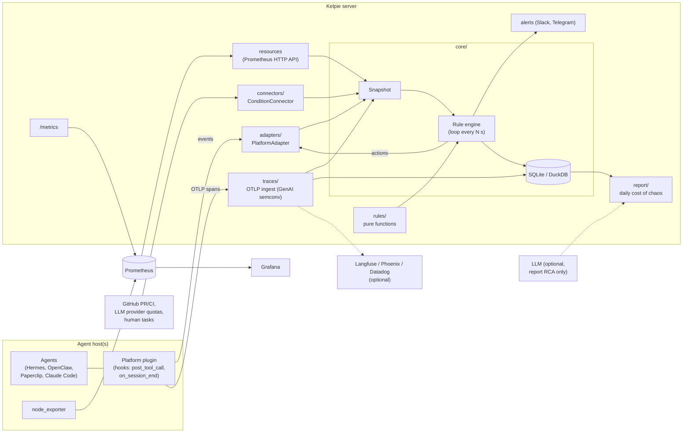

# Kelpie

> **Status: pre-alpha.** Interfaces, config and storage formats will change without notice.
> Most components below are design-level or stubs. Do not point Kelpie at a production
> task board with `dry_run` disabled yet.

**Open-source SRE and throughput optimization for AI agent farms**: Hermes, OpenClaw,
Paperclip, Claude Code, Codex and similar setups where many agents pull tasks from a shared
board, wherever they run: a laptop, a cloud VM, containers or Kubernetes.

Kelpie is a **service, not an LLM agent**. It watches your task board, agent sessions,
traces and host resources, and applies **deterministic rules** to keep work flowing:
it requeues tasks that agents abandoned, wakes tasks whose wait condition is met, lifts
stale blocks, escalates review ping-pong, cancels wasted CI builds and warns before disks,
quotas or logins run out. An LLM is optional and only used for root-cause analysis in the
daily report.

Scope, priorities and order of work live in [docs/plan.md](docs/plan.md), the single source
of truth; the issue backlog is [docs/roadmap.md](docs/roadmap.md).

- PyPI: `kelpie-sre` (not published yet) · CLI: `kelpie`
- License: Apache-2.0 · Repo: [github.com/ch8er/kelpie](https://github.com/ch8er/kelpie)

## Why

Agent farms fail in boring, repetitive ways, and every failure costs hours of idle agents.
The rules in Kelpie come from 13 real incidents on one farm:

| #  | Incident | What Kelpie does |
|----|----------|------------------|
| 1  | Tasks stuck in the dispatcher guard (dozens of manual unblocks) | Stale blocks |
| 2  | Agent exited without a final status, or set a block instead of returning the task | Exit contract |
| 3  | Disk at 99% | Resources |
| 4  | Host overloaded, heavy task queue of 1.5–2 h | Resources + heavy-task concurrency limit |
| 5  | CI minutes ran out (11 h idle) | CI economy and quota burn forecast |
| 6  | LLM provider limits and expired logins (up to 200 hits/day) | Resources: provider quotas and auth health |
| 7  | Conflicts in shared files (46 of 63 returns) | Return causes: root-cause analysis from traces → recommendation |
| 8  | Block lingered 3 h after the cause was fixed | Stale blocks |
| 9  | Idle agents due to a sequential task graph | Bottlenecks: role utilization and critical path |
| 10 | Agent waited for an external event inside its session; the dispatcher declared it dead | Wait for condition + "waiting" heartbeat; bottlenecks |
| 11 | Task stuck in a status with no owner, 7 tasks blocked | Orphan statuses |
| 12 | 9 review rounds on a single task | Ping-pong → escalation |
| 13 | Human tasks blocked agents | Bottlenecks: humans in the task graph, with cost of delay |

Kelpie must also measure the effect of a fix by itself. Example from the farm: after a
manual fix, review time dropped from 48 to 27 minutes, and failures from 9 of 29 to 1 of 11.

## Key ideas

- **Deterministic control loop.** Every N seconds the engine builds an immutable
  `Snapshot` (tasks, owners, dependencies, conditions, resources, sessions, spans) and runs
  every rule over it. No LLM is involved in deciding what to do.
- **Rules are pure functions.** A rule takes a snapshot and returns a list of `Action`s
  (`requeue`, `unblock`, `comment`, `wip_commit`, `wake`, `reassign`, `escalate`, `alert`).
  It does no I/O and reads time only from `snapshot.now`, so each rule is tested with
  plain YAML fixtures.
- **Actions only go through adapters.** The engine dispatches actions to a
  `PlatformAdapter`; rules never touch a platform directly. The engine is dry-run by default.
- **Core knows no platform and no CI.** `kelpie.core` never imports `adapters/` or
  `connectors/`; integrations implement protocols from `kelpie.core.ports`.
- **Don't reinvent monitoring.** Host resources come from node_exporter + Prometheus
  (read via the Prometheus HTTP API). Traces follow the OpenTelemetry GenAI semantic
  conventions and can be exported to Langfuse. Kelpie exposes its own `/metrics`.
- **Wait for conditions, don't poll inside sessions.** An agent registers a condition
  (CI green, PR merged, quota reset, human task done) and exits; Kelpie wakes the task when
  the condition holds.
- **Measure the cost of chaos.** A daily report shows idle hours and tokens burned on
  restarts, what Kelpie fixed, what needs a human, and the before/after effect of each fix.

**Use what exists, do not build.** Kelpie runs on top of platforms, not instead of them.
"Who is doing what" dashboards already exist (Claude Code Agent View, hermes-monitor,
Minions); single-session loop and budget guards exist too ([AgentWatchdog](https://github.com/jusong/agentwatchdog),
whose thresholds Kelpie reuses: 8 repeats in 10 minutes, 5 errors in a row); deep
single-agent optimization is left to HALO, Langfuse and Papaya via trace export. Kelpie's
value is logic over the task graph and automatic repair.

## Architecture



The Kelpie server can run anywhere. Adapter plugins and node_exporter run where the
agents run.

## Rules (MVP)

| # | Rule | What it does | Incidents |
|---|------|--------------|-----------|
| 1 | Exit contract | Session ended without a final status, or with a block lacking an allowed reason → requeue | 2 |
| 2 | Wait for condition | Agent registers a condition and exits; Kelpie wakes the task when it holds and keeps a "waiting" heartbeat meanwhile. Detects in-session polling | 10 |
| 3 | Orphan statuses | Task sits in a status with no owner for more than N min → alert and reassign to an owner of its role | 11 |
| 4 | Stale blocks | The block's cause is resolved in the outside world → unblock | 1, 8 |
| 5 | Ping-pong | After K review rounds → escalate to the architect or a human | 12 |
| 6 | Bottlenecks | Role utilization and critical path → alert with a rebalancing suggestion; humans in the task graph, escalated with the cost of delay | 9, 10, 13 |
| 7 | Resources | Disk, memory, processes, heavy-task concurrency, LLM provider quotas and auth health → alert before the agents stop | 3, 4, 6 |
| 8 | Daily report | "Cost of chaos" plus before/after verification of every fix | all |
| 9 | CI economy | Finds wasted builds (drafts/WIP, superseded, docs-only, already verified commit), cancels superseded ones, forecasts quota burn, proposes a better CI config PR | 5 |
| – | Return causes (P1) | Root-cause analysis of task returns from traces → recommendation | 7 |

Rule names in code: `exit_contract`, `wait_condition`, `orphan_status`, `stale_blocks`,
`ping_pong`, `bottlenecks`, `resources`, `ci_economy`, `return_causes`, `checkpoints`.

Foundation work alongside the rules (no LLM): **traces** (OpenTelemetry GenAI spans over
OTLP, stored locally, optionally forwarded to Langfuse, Phoenix or Datadog; adapters write
spans from hooks if a platform emits none) and **checkpoints** (commit reminder after N
minutes or M changed files, WIP commit on exit to a draft PR or with `[skip ci]`, resume
from the last commit with a progress note). Next step (P1): basic token optimization and
farm throughput metrics from traces.

## Reporting (planned)

- **Real-time alerts** to Slack or Telegram: only actionable items, always stating what
  Kelpie already did by itself; duplicate alerts are merged.
- **Daily report**: cost of chaos (idle hours, tokens burned on restarts), what Kelpie
  fixed by itself, what needs a human decision, before/after effect of yesterday's fixes,
  top 3 optimization recommendations.
- **Dashboards**: no custom UI. Kelpie exposes Prometheus metrics on `/metrics`, Grafana
  shows them, traces open in Langfuse. CLI: `kelpie status` and `kelpie report`.

## Quickstart

> While Kelpie is pre-alpha, `kelpie serve` only exposes `/metrics` and `/healthz`
> on port 9464; the control loop, adapters and connectors are not wired up yet.

Requirements: Python 3.12 and [uv](https://docs.astral.sh/uv/).

```bash
git clone https://github.com/ch8er/kelpie.git
cd kelpie
uv sync
uv run kelpie serve
```

Or run the full stack (Kelpie, Prometheus, Grafana) with Docker:

```bash
cp .env.example .env   # set GRAFANA_ADMIN_PASSWORD
docker compose up
```

Ports are bound to `127.0.0.1` (Kelpie 9464, Prometheus 9090, Grafana 3000). Add
`--profile local-agents` to also run node_exporter when agents share the server host.

Install node_exporter and the platform plugin (for example the Hermes plugin) on each host
where agents run, and point them at the Kelpie server.

## Project layout

```text
src/kelpie/
  core/         domain model, rule contract, engine, ports (protocols), serde
  rules/        one module per rule: pure functions over a Snapshot
  adapters/     PlatformAdapter implementations (Hermes first)
  connectors/   ConditionConnector implementations (GitHub, LLM quotas, human tasks)
  traces/       OTLP ingest, span storage, optional export (Langfuse, Phoenix, Datadog)
  report/       daily cost-of-chaos report, before/after comparisons
  cli.py, server.py     `kelpie` CLI and HTTP server (/metrics, /healthz)
tests/
  fixtures/incidents/   YAML snapshots + expected actions, one or more per incident
deploy/                 Prometheus and Grafana config
docs/
  plan.md       scope, priorities and 3-week plan (single source of truth)
  roadmap.md    issue list (source for scripts/create_issues.sh)
scripts/
  create_issues.sh      creates GitHub issues from docs/roadmap.md
docker-compose.yml      kelpie + prometheus + grafana
```

What exists today: the domain model, action types, the rule protocol and registry,
adapter/connector protocols, a minimal dry-run engine, fixture deserialization, the
`kelpie serve` HTTP stub and 13 incident fixtures. Adapters, connectors, traces, storage,
alerters and the report are stubs, `kelpie status` and `kelpie report` do not exist yet,
and no rule is implemented yet; see
[docs/plan.md](docs/plan.md) and [docs/roadmap.md](docs/roadmap.md).

## Contributing

See [CONTRIBUTING.md](CONTRIBUTING.md). Security issues: see [SECURITY.md](SECURITY.md).

## License

Apache License 2.0. See [LICENSE](LICENSE).
